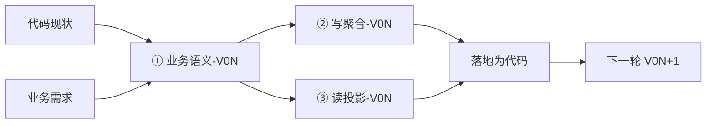
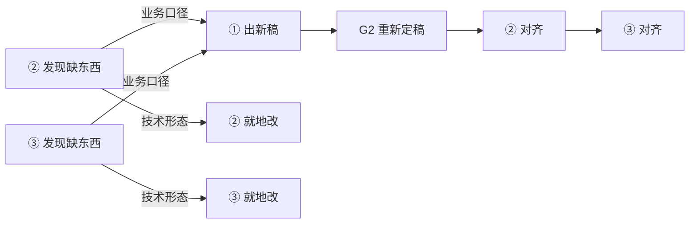

# 聚合设计文档标准（三件套 + 轮次 · 总说明与索引）

> 本文是 `ddd-design-doc` 能力产出设计文档的**总说明与索引**。
> 一个聚合每一轮产出**三件套**：业务语义 / 写聚合 / 读投影，文件名带轮次后缀（`-V01`、`-V02`）。
> **现状不落文档**，一律以代码为准：每轮按 §5.0 勘察清单现读，不缓存。
> 本文只定义分级结构、轮次规则与通用规则，具体骨架见三份模板。

## 1. 为什么现状不落文档

事实源只有两个：**代码**（现在实际是什么）与**语义文档**（这次应该是什么）。中间再存一份「当前态文档」会随代码腐化；一旦不可信，用它前必须核验，而核验手段就是读代码——读完它已无价值。

- **语义**：本轮需求的意图，落地后冻结。
- **技术设计**：本轮的实现形态，落地后冻结。
- **现状**：代码本身，每轮开场按 §5.0 清单现读。

判据：**记录「状态」的东西一定会过期，记录「意图」的东西不会。** 所以只存意图。

## 2. 三件套与分级结构

### 2.1 分级结构

| 层级 | 单位 | 边界由谁定 |
| --- | --- | --- |
| 需求 | `changes/active/{需求}/`（`{YYYYMM}-{slug}` 或需求系统编号） | 人：明确是新需求才新建 |
| 聚合 | `{需求}/{agg}/` | 涉及几个聚合就几个目录 |
| 轮次 | 文件名后缀 `-V{NN}` | 每聚合目录内独立递增 |

### 2.2 三件套

| # | 文档 | 定位 | 落盘 | 结束方式 |
| --- | --- | --- | --- | --- |
| ① | [业务语义](./design-doc-semantics) | 本轮这个聚合应该是什么 | `changes/active/{需求}/{agg}/semantics-V{NN}.md` | 落地后与另两份一同冻结 |
| ② | [写聚合设计](./design-doc-write-template) | 本轮怎么写（模型 + 关系表），统管横切 | 同目录 `aggregate-design-V{NN}.md` | 同上 |
| ③ | [读投影设计](./design-doc-read-template) | 本轮怎么查（读模型 + 读源） | 同目录 `projection-read-V{NN}.md` | 同上 |

- **每轮固定三份**：不适用时薄写「本轮无变更 ｜ 原因 ｜ 见 `xxx-V{M}.md` §N」，不省略、不跳号。
- **不覆盖写**：每轮各一份，历史文件全部保留；旧轮次不删、不合并。
- ② 统管横切（改动清单 / 测试 / 风险 / 实施备注）；③ 不设这三章。
- ① 只写**本轮受影响章节**，其余写「无变更，见 `semantics-V{M}.md` §N」；与代码的差异就地标 `（当前：xxx）`。
- **不设接口层章节**：HTTP / RPC 端点、Request / Response DTO 不在范围内。

### 2.3 编号与头部

对外只有一个编号：**轮次 `V{NN}`**；文档内部的「第 N 稿」只表示本轮内改了几次，不对外引用。

| 编号 | 含义 | 作用域 | 对外 |
| --- | --- | --- | --- |
| `V{NN}` | 轮次 | 单聚合目录内递增 | **唯一对外编号** |
| `第 N 稿` | 本轮内修订稿次 | 单份文档内 | 不引用 |

三份文档头部统一：

```text
轮次：V02 ｜ 第 2 稿 ｜ 状态：草稿 / 已确认 / 修订中 / 已落地 / 已归档
代码基线：abc123（核对 2026-11-05）
```

- 引用一律写 `semantics-V02.md §5`，不写「① v3」。
- 语义未定稿不得动技术设计；三份都定稿后才交棒实施。
- `已落地` = 按 §5.3 三条核对通过；`已归档` = 需求交付后整目录搬走。

## 3. 推导关系



- ①②③ 的推导**单向**：下游只翻译上游，不改写意图。
- 「当前态」是**代码本身**，每轮开场按 §5.0 现读，不经任何中间文档。
- 一轮结束 = 代码落地 + §5.3 三条核对通过；此后三份文档冻结。

### 3.1 回流矩阵

推导单向下行，但**发现问题的方向可以是向上的**。下游对上游只能「提请」，不能自己落地；`②§10.x` 的待定表是登记台，不是修复台——只登记不回流，① 会被架空。

**回流只发生在落地前**：三份文档一旦按 §5.3 核对通过（已落地），发现漏了就开下一轮 `V{N+1}`，不在本轮改。

判别式：**改的是「业务上说得通吗」→ 回 ①；改的是「技术上怎么落」→ 停在 ②③；两句话都沾 → 先拆成两件事，分别落。**

| # | 在哪发现 | 发现什么 | 回流到 | 动作 |
| --- | --- | --- | --- | --- |
| B1 | ② | 要新增 / 改一条业务规则 R | **①** | ①§5 加规则与编号 → ① 升版定稿 → ②§4、§1.4 对齐 |
| B2 | ② | 要加一个动作，或动作写入的字段变了 | **①** | ①§3 先改 → ②§3、§6 对齐 |
| B3 | ② | 事件载荷不够用（要加字段） | **①** | ①§4.1 载荷先改 → ②§5 对齐 |
| B4 | ② | 状态维度或流转条件变了 | **①** | ①§6 先改 → ②§3.3、§3.4 对齐 |
| B5 | ② | 表结构、索引、TypeHandler、执行顺序、操作码与消息码常量 | **止于 ②** | 记 §10.1 设计增量，不惊动 ① |
| B6 | ③ | 需要一个 ① 里没有的查询场景 Q | **①** | ①§8 新增 Q（编号只增）→ ① 定稿 → ②（涉及字段 / 索引时）→ ③ |
| B7 | ③ | 查询要的字段 ② 的表里没有 | 属性在 ① 有 → **②**；① 也没有 → **①** | 先判「业务属性缺失」还是「持久化缺失」 |
| B8 | ③ | 数据同步事件不够用（时机 / 载荷无法构造投影） | **①**（§4）+ **②**（§5、§6.8） | 载荷与时机属业务事实，不回 ① 就只能瞎补 |
| B9 | ③ | 读源选型、mapping、`REPLICA_ID`、TTL、分片、裁剪粒度、分页、查询索引 | **止于 ③** | 就地改，② 不动 |
| B10 | ③ | 业务筛选维度口径不明（如「近 7 天」从哪天算） | **①** | ①§8 + 附录 A 术语口径 |
| B11 | 任意 | 与代码实际不一致 | **①** | ① 就地标 `（当前：xxx）`，不擅自抹平 |

两条总则：

1. **上游优先、单一落点**：业务事实只有 ① 一个写入口。②③ 发现要加规则 / 动作 / 字段 / 载荷，先回 ① 改并定稿，再回 ②③ 对齐。
2. **不跳级**：回流一次只往回走一档，顺序固定 `① 定稿 → ② 对齐 → ③ 对齐`。① 未定稿就改 ③，等于在流沙上盖房。

### 3.2 闸门重走

回流不是补丁，而是重走闸门：① 进入「修订中」，定稿后 G2 重过 → ② 对齐 → ③ 对齐。流程图与硬约束见 §5.5。

## 4. 通用规则

- **结论先行、不写论证**：只产出产物（表 / 骨架 / DDL / mapping / 清单），不写「为什么这么设计」。
- **单一事实源**：业务意图只在 ①，技术形态只在 ②③，**当前实现只在代码**。
- **编号稳定**：规则 `R1..Rn`、查询 `Q1..Qn` 跨文档不变，分配后不重排。
- **未定项集中**：框架签名、业务待确认、实施备注全部收在 ② §10。
- **前置条件先行**：动笔前核对 [实施前置条件](./design-doc-prerequisites)，未确认项只写结构与占位。
- **一轮三份**：固定产出三件套；不适用时薄写，不省略、不跳号。
- **上游优先**：业务意图只在 ① 落地；下游只提请不改写，回流规则见 §3.1。
- **落地即冻结**：代码落地后三份文档不再修改，只允许文字勘误与实施备注（见 §5.4）。
- **不设接口层章节**：HTTP / RPC 端点、Request / Response DTO 不在范围内。

## 5. 一轮怎么走

一轮 = 语义 → 技术设计（两份）→ 落地 → 冻结。固定产出，不需要点单。

### 5.0 代码勘察清单（每轮开场）

**不产出文档**。确定性来自「每次读同样的东西」，而不是「读一份固定的文档」——固定文档会腐化，固定清单不会。

| # | 观察目标 | 提取内容 | 需判断 |
| --- | --- | --- | --- |
| 1 | 聚合根 + 子实体 | 字段 / 充血方法 / `initData` / 构造期事件 | 否 |
| 2 | 枚举类 | 实际 code 值 | 否 |
| 3 | 操作注册表 / 规则注册表 | 操作码 / 消息码；注册表外的方法要对照 | 是 |
| 4 | 规则容器 `addRule` 的 lambda | 组 A/B/C / 激活条件 / **判定基准读 `old` 还是当前态** | **是** |
| 5 | DDL + Mapper | 表 / 索引 / 列形态（A 展开 / B JSON / search 生成列）/ TypeHandler | 是（不一致时以实际库为准） |
| 6 | 事件类 + 订阅登记 | 事件 / 载荷 / 构造方式 / 订阅方 | 否 |

- 勘察结果**不进文档**：差异就地写进 ① 对应条目（`（当前：xxx）`）。
- 第 4 项必须读 lambda 体——看签名看不出读的是 `old` 还是当前态。

### 5.1 四个阶段

| 阶段 | 做什么 | 产出 |
| --- | --- | --- |
| 1 输入 + 勘察 | 解析需求；按 §5.0 清单读代码 | 无文档 |
| 2 出语义（G1 → G2） | ① 可多稿；用户显式说「定稿」才置「已确认」 | `semantics-V{NN}.md` |
| 3 出技术设计 | ② + ③ 各一份，不跳过任一份（不适用就薄写） | `aggregate-design-V{NN}.md`、`projection-read-V{NN}.md` |
| 4 落地 + 核对 | 交下游实施 → 按 §5.3 核三条 → 三份置「已落地」 | 代码 |

- 语义未定稿不得动 ②③。
- **取消点单**：不再问「要不要出写设计 / 要不要出投影」，一轮就是三份。
- **纯技术轮也出 ①**，只是薄写（一节说明「本轮无业务语义变更 + 影响面」），不再有「跳过语义」的分支。
- 新建与迭代的区别只在基线：新建头部写「基线：无（新建）」，迭代写「基线：`semantics-V{M}.md` + 代码 commit」。

### 5.2 语义文档的本轮稿次（G1 → G2）

| 稿次 | 做什么 | 不做什么 |
| --- | --- | --- |
| 第 1 稿 | 新建：全量 8 章骨架；迭代：受影响章节 + 基线引用；待确认项全部进附录 C | 不猜业务、不替业务方编查询场景 |
| 第 2..N 稿 | 只改指出的章节 + 被其连带影响的章节（改动作则 3.1 / 3.2 / 5.3 / 6.4 同批对齐）；R / Q 编号只增不改 | 不整篇重写、不重排编号、不顺手美化未触及章节 |
| 每稿汇报 | 三行：改了哪几章 / 新增或改动了哪些 R·Q·动作 / 附录 C 还剩什么 | 不汇报未改动的内容 |
| 定稿 | 跑自检，附录 C 清空或逐条标「接受」，状态改「已确认」 | 定稿后不再静默修改 |

### 5.3 落地核对（一轮结束的判据）

「代码落地了」不能是自我声明。用现成三张表核三条，不新增检查表：

| # | 核对项 | 依据 | 通过标准 |
| --- | --- | --- | --- |
| 1 | 改动清单 | ② §8 | 每行都有对应实现 |
| 2 | 操作码与规则 | ② §3.1 / §4.4 | 注册表能查到每个操作码；规则容器 `addRule` 与 §4.4 逐列一致：消息码 / 组 / 激活条件 / 读取字段（`old` 还是当前态） |
| 3 | 查询族与读服务 | ③ §6 | 每条 Q 都有实现，能编译通过 |

- 三条全过 → 三份文档状态置「已落地」，本轮结束。
- 任一不过 → **改代码**；尚未宣布落地前也可以**改设计**。不允许带着不一致宣布落地。

### 5.4 冻结与两个例外

落地后三份文档**设计内容不再修改**。只允许两类例外：

| 例外 | 范围 | 边界 |
| --- | --- | --- |
| 文字勘误 | 错别字、失效链接、表格格式、编号笔误 | 不改变任何结论 |
| 实施备注 | 写 ② §10.6：设计未细化处的实施事实（框架签名核实结果、方言细节、装配细节） | 只记事实，不改结论，不记「设计一套、实施一套」 |

设计内容（规则 / 字段 / 动作 / 事件 / 状态 / 表结构 / 查询）要变 → **开下一轮**，不在本轮改。

### 5.5 回流（仅落地前）

②③ 发现上游缺东西，按 §3.1 回流矩阵处理，逐级只回一档：



- ① 处于「修订中」时，②③ 不得继续推进；① 定稿后 ②③ 置「待对齐」，按 ② → ③ 顺序补齐。
- ③ 最容易暴露 ① 缺口（查询场景最晚想清），每次都回在 ② §10.2 留一行。
- **已落地后不再回流**：缺陷型问题改代码；设计要变则开下一轮 `V{N+1}`。

### 5.6 一致性校验（落地前跑一次）

用集合关系核对，不靠肉眼：

1. ① 的 R / 动作 / 事件 / 状态维度 **⊆** ② §1.4 追溯覆盖面，且 ② 不得出现 ① 没有的动作。
2. ③ 的 Q 集合 **=** ① §8 的 Q 集合（不多不少、编号不改）。
3. ③ §1.2 来源事件 **⊆** ② §5.1 事件清单。
4. ③ §3.1 投影字段 **⊆** ② §7 表结构（枚举已降级）。
5. 三件套齐全；薄写的要在正文写清「无变更 + 原因 + 指向上一轮文件」；① 无「未定」项；三份不为「待对齐」。

### 5.7 归档与止损

**归档** = 需求交付后把 `changes/active/{需求}/` 整目录移到 `changes/archive/{需求}/`，各轮文件一起走。归档判据：§5.3 三条核对已过（三份都是「已落地」）。

两条止损线：

- **本轮内 ≥ 3 稿仍在改语义**：说明需求本身没定，停下来回业务澄清，不要在设计里试错。
- **落地后不得回改**：发现遗漏开下一轮 `V{N+1}`，不在已落地的那一轮里改。

### 5.8 轮次判定：同目录加 `-V{N+1}` 还是新建需求目录

默认：**能推出来就加后缀，推不出来就建新目录。** 三条全满足才加后缀：

| # | 判据 |
| --- | --- |
| 1 | 业务目标相同：同一批业务对象、同一件事的延续 |
| 2 | 上一轮三件套就在同一目录，且能作基线（能引用具体章节） |
| 3 | 能写出「本轮替代上一轮什么」：哪几条 R / 哪个动作 / 哪个查询 |

任一含糊 → 新建需求目录（保守默认，新目录成本只是一个文件夹）。拿不准时给判断 + 推荐，由用户拍板。

## 6. 与旧文档的映射

早期版本把设计文档分成「写 / 读」两份（12 节 / 7 节），后演进为三层，现为三件套 + 轮次。已产出的旧文档按此表对齐：

| 旧内容 | 现在的位置 |
| --- | --- |
| 原 §1 概述与背景、聚合边界与职责 | ① 语义第 1 章 |
| 原 §3 领域模型静态结构 | ② 写 §2 |
| 原 §4 状态与行为设计 | ② 写 §3 |
| 原 §5 业务规则设计 | ② 写 §4（业务表述在 ① 第 5 章） |
| 原 §6 领域事件设计 | ② 写 §5（业务含义在 ① 第 4 章） |
| 原 §7 表结构 / 映射 / 仓储 | ② 写 §7（实际列与索引看代码） |
| 原 §8 应用层设计 | ② 写 §6 |
| 原 §9 接口层设计 | 不写 |
| 原 §10 时序 | 并入 ② 写 §6 执行顺序 |
| 原 §11 改动清单 / §12 测试 / §13 风险 | ② 写 §8 / §9 / §10 |
| 原投影部分 | ③ 投影读整份 |
| 原「聚合当前态」类文档 | 取消。现状看代码 |

## 7. 存量项目怎么起步

存量项目没有契约基线，直接写 ① 会失去基线。推荐顺序：

1. **先跑一次 §5.0 勘察清单**：摸清聚合根 / 枚举 / 注册表 / 规则容器 / DDL + Mapper / 事件。
2. 再对**本轮要改的聚合**开 `V01` 写三件套，其余聚合等有需求时再补。
3. 不要为没有需求的聚合预先补文档——补出来的没人用，只会过期。
4. 也不要把勘察结果整理成一份「当前态文档」——它从写下那一刻就开始过期。

## 8. 已知缺口

| 缺口 | 现状 | 后续 |
| --- | --- | --- |
| 前置条件清单模板 | 仓库 `docs/design/prerequisites.md`（项目数据）；模板示例 `docs/design/documentation/实施前置条件清单示例.md`，均未进文档站 | 按项目实际情况定 |
| 勘察清单的自动化 | 6 类观察项已固定，但仍是人工逐项读取，无脚本支撑 | 按需补探测脚本 |
| 语义多轮留痕 | 目前只靠头部状态行 + git，无逐轮 diff 记录 | 按需补轮次日志 |
