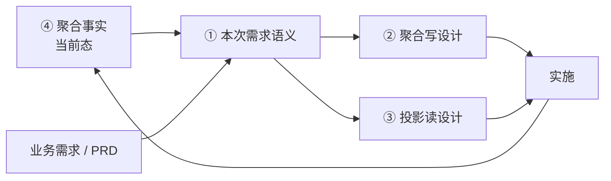

# 聚合设计文档标准（三契约 + 一快照 · 总说明与索引）

> 本文是 `ddd-design-doc` 能力产出设计文档的**总说明与索引**。
> 一个聚合的文档分四份：**三份契约**（本次需求语义 / 写设计 / 投影读设计）+ **一份快照**（聚合事实）。
> 本文只定义分层关系与通用规则，具体骨架见四份模板。

## 1. 为什么分契约与快照

契约回答「这次答应了什么」，快照回答「现在实际是什么」。两者混成一份，就会产生「文档写着 A、代码做着 B，而文档看起来是对的」这种最难查的问题。

- **契约**：每次需求产出一份，验收或实施后归档，不再修改。它是历史凭证，不是当前事实。
- **快照**：唯一一份，从代码推导，每次实施后覆盖更新。下次需求从这里读当前态。

分开之后，「业务说 A、实际是 B」会显性暴露在事实文档里，而不是被文档作者顺手抹平。

## 2. 四份文档与定位

| # | 文档 | 性质 | 定位 | 落盘 | 结束方式 |
| --- | --- | --- | --- | --- | --- |
| ① | [本次需求语义](./design-doc-semantics) | 契约 | 本次需求中它应该是什么 | `docs/design/changes/active/{需求}/{agg}/semantics.md` | 验收后归档 |
| ② | [聚合写设计](./design-doc-write-template) | 契约 | 本次怎么实现（写模型 + 关系表） | `docs/design/changes/active/{需求}/{agg}/aggregate-design.md` | 实施后归档 |
| ③ | [投影读设计](./design-doc-read-template) | 契约 | 本次怎么查（读模型 + 读源结构） | `docs/design/changes/active/{需求}/{agg}/projection-read.md` | 与②同批归档 |
| ④ | [聚合事实](./design-doc-facts) | **快照** | 现在实际是什么 | `docs/design/aggregates/{agg}/facts.md` | **永不归档** |

- ①②③ 共用同一个需求目录（`{YYYYMM}-{slug}` 或需求系统编号）；归档即把 `changes/active/{需求}/` 整体移到 `changes/archive/{需求}/`，不改名；目录标识本身即版本。
- 目录只有两条线：`changes/`（需求维度，活动 / 归档）与 `aggregates/`（聚合维度，只放 facts）；项目级前置条件清单在 `docs/design/prerequisites.md`。
- ② 为主文档，统管横切（改动清单 / 测试 / 风险 / 实施回填）；③ 不设这三章。
- ① 只写**本次受影响章节**，其余引用 ④ 基线（见 `design-doc-semantics` §1.2）；与事实的差异就地写在对应条目上。
- ④ **只写代码事实**，完全从代码推导，不依赖语义基线；未修问题只在 §4 保留摘要。

## 3. 推导关系

- ①②③ 的推导是**单向**的：下游只翻译上游，不改写事实。
- ④ 的推导方向相反：**从代码推出**，吸收 ② 的 §10.6 回填。
- 下次需求从 ④ 起步，不从旧设计文档起步——旧文档已归档。

| 情况 | 处理 |
| --- | --- |
| 语义有、设计要落地 | 在设计文档 §1.4 建元素级追溯 |
| 语义没写、设计必须决定 | 记入写文档 §10.1 设计增量 |
| 语义与实现不一致 | **写在语义文档对应条目上**（就地标 `（当前：xxx）`）；代码侧未修的进 ④ §4 摘要 |
| 设计发现新业务约束 | 记入写文档 §10.3 业务待确认 |

## 4. 通用规则

- **结论先行、不写论证**：只产出产物（表 / 骨架 / DDL / mapping / 清单），不写「为什么这么设计」。
- **单一事实源**：业务意图只在 ①，当前实现只在 ④，技术形态只在 ②③。
- **编号稳定**：规则 `R1..Rn`、查询 `Q1..Qn` 跨文档不变，分配后不重排。
- **未定项集中**：框架签名、业务待确认、实施偏差全部收在 ② §10。
- **前置条件先行**：动笔前核对 [实施前置条件](./design-doc-prerequisites)，未确认项只写结构与占位。
- **三份契约归档、快照不归档**：①②③ 实施后冻结；④ 随代码持续更新。
- **不设接口层章节**：HTTP / RPC 端点、Request / Response DTO 不在四份范围内。

## 5. 使用顺序

**新建聚合**

1. 定需求名并建目录：`changes/active/{需求}/{agg}/`（可用 `agent-skills/scripts/design-doc-workspace.sh new <需求> <agg>`）。
2. 核对前置条件清单。
3. 写 ① 本次需求语义（全量，头部标「基线：无（新建）」），交业务方确认。
4. 确认后写 ②③。
5. 三份自检 + 交叉核对。
6. 实施。
7. 填 ② §10.6 → 产 ④ 初始版本（从代码推导）→ **归档**（需求目录从 `active/` 移到 `archive/`）。

**迭代需求**

1. 读 ④ 当前态：`aggregates/{agg}/facts.md`。
2. 核对前置条件清单。
3. 建新需求目录 `changes/active/{新需求}/{agg}/`。
4. 写 ① 本次需求语义：按章标「重列 / 无变更，见基线 / 新增 / 废弃」，头部标基线。
5. 确认后写 ②③（同目录，文件名不带版本号）。
6. 实施。
7. 填 ② §10.6 → **覆盖更新 ④**（含 §4 偏离）→ **归档**。

第 7 步是硬约束：④ 未更新，下次迭代不得开始。

**归档动作**固定为目录移动：`changes/active/{需求}/` → `changes/archive/{需求}/`。三条判据全满足才移动：①②③ 完成、涉及的 `aggregates/{agg}/facts.md` 已更新、② §10.6 已回填。

## 6. 与旧文档的映射

早期版本把设计文档分成「写 / 读」两份（12 节 / 7 节），后演进为三层，现为三契约 + 一快照。已产出的旧文档按此表对齐：

| 旧内容 | 现在的位置 |
| --- | --- |
| 原 §1 概述与背景、聚合边界与职责 | ① 语义第 1 章 |
| 原 §3 领域模型静态结构 | ② 写 §2 |
| 原 §4 状态与行为设计 | ② 写 §3 |
| 原 §5 业务规则设计 | ② 写 §4（业务表述在 ① 第 5 章） |
| 原 §6 领域事件设计 | ② 写 §5（业务含义在 ① 第 4 章） |
| 原 §7 表结构 / 映射 / 仓储 | ② 写 §7（实际列与索引进 ④ §3.4） |
| 原 §8 应用层设计 | ② 写 §6 |
| 原 §9 接口层设计 | 不写 |
| 原 §10 时序 | 并入 ② 写 §6 执行顺序 |
| 原 §11 改动清单 / §12 测试 / §13 风险 | ② 写 §8 / §9 / §10 |
| 原投影部分 | ③ 投影读整份 |
| 原「聚合当前态」类文档 | ④ 聚合事实 |

## 7. 存量项目怎么起步

存量项目没有 ④，直接写 ① 会失去基线。推荐顺序：

1. **先补 ④**：用「现状型」入口从代码推导事实文档（`design-doc-facts` §6.1 给了核对顺序）。
2. 再对**本次要改的聚合**补 ①，其余聚合等有需求时再补。
3. 不要为没有需求的聚合预先补文档——补出来的没人用，只会过期。

## 8. 已知缺口

| 缺口 | 现状 | 后续 |
| --- | --- | --- |
| 前置条件清单模板 | 仓库 `docs/design/prerequisites.md`（项目数据）；模板示例 `docs/design/documentation/实施前置条件清单示例.md`，均未进文档站 | 按项目实际情况定 |
| ④ 的自动生成 | 模板已定义推导顺序，尚无脚本或 skill 步骤实现 | 集成进 `ddd-design-doc` 的现状型分支 |
