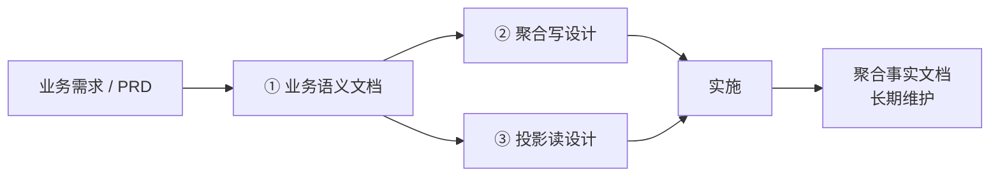

# 聚合设计文档标准（三层 · 总说明与索引）

> 本文是 `ddd-design-doc` 能力产出设计文档的**总说明与索引**。
> 一个聚合的文档分三层：**业务语义 → 写设计 → 投影读设计**，每层一份模板、一份产出物。
> 本文只定义分层关系与通用规则，具体骨架见三份模板。

## 1. 为什么是三层

一个聚合的交付要回答三类问题，混在一起就会互相污染：

- **它是什么**（业务语义）：记得什么、能做什么、宣告什么、受什么约束、怎么变、被怎么查——业务方与开发共同确认。
- **怎么写**（写设计）：这些语义落到类、规则容器、事件、表、应用层怎么做——开发实施。
- **怎么查**（投影读设计）：副本怎么建、索引长什么样、查询怎么走——开发实施。

分成三层的好处：语义层可以被业务方评审而不被技术细节干扰；设计层可以交给实施者而不用再判断业务；每一层都有独立的验收标准。

## 2. 三份文档与定位

| # | 文档 | 定位 | 落盘命名 | 生命周期 | 统管横切？ |
| --- | --- | --- | --- | --- | --- |
| ① | [业务语义](./design-doc-semantics) | 业务事实：属性 / 动作 / 事件 / 规则 / 状态 / 依赖 / 查询场景 | `docs/design/documentation/{聚合名}-business-semantics.md` | 版本级，随需求演进 | ❌ |
| ② | [聚合写](./design-doc-write-template) | 写模型 + 关系表持久化 | `docs/design/{聚合名}-aggregate-design-v{N}.md` | 一次性，实施后归档 | ✅ 统管整体（改动清单 / 测试 / 风险 / 回填） |
| ③ | [投影读](./design-doc-read-template) | 读模型 + 读源结构（ES / Redis / 数据库直读） | `docs/design/{聚合名}-projection-read-design-v{N}.md` | 一次性，与写同批归档 | ❌ 只聚焦自身 |

三份共用同一 `v{N}`；语义文档额外标「依据：代码现状 / PRD 版本」。

## 3. 推导关系

推导是**单向**的：下游只翻译上游给定的事实，不改写事实。

| 情况 | 处理 |
| --- | --- |
| 语义有、设计要落地 | 在设计文档 §1.4 建元素级追溯 |
| 语义没写、设计必须决定 | 记入写文档 §10.1 设计增量 |
| 语义与实现不一致 | 记入写文档 §10.2 语义缺口 |
| 设计发现新业务约束 | 记入写文档 §10.3 业务待确认，不擅自改语义 |

## 4. 通用规则

- **结论先行、不写论证**：三份都只产出产物（表 / 骨架 / DDL / mapping / 清单），不写「为什么这么设计」。
- **单一事实源**：同一件事只在一处定义，其他文档引用编号或章节。
- **编号稳定**：规则 `R1..Rn`、查询 `Q1..Qn` 跨文档不变，分配后不重排。
- **未定项集中一处**：框架签名待核实、业务待确认、实施偏差全部收在写文档 §10，语义与读文档只引用。
- **前置条件先行**：动笔前核对 [实施前置条件](./design-doc-prerequisites)，未确认项对应的章节只写结构与占位。
- **一次性归档**：写与读两份实施完成后归档，事实由「聚合事实文档」承接，不再反向修改设计文档。
- **不设接口层章节**：HTTP / RPC 端点、Request / Response DTO 不在三份范围内。

## 5. 使用顺序

1. 核对前置条件清单，未确认项登记。
2. 写**业务语义文档**（8 章 + 3 附录），交业务方确认。
3. 语义确认后写**聚合写设计文档**（11 节），从语义第 3、5 章推导操作码与规则。
4. 写**投影读设计文档**（6 节），从语义第 8 章的 Q 编号推导查询族与读源。
5. 三份各自跑自检，交叉核对追溯与 Q 编号。
6. 实施完成后：填 §10.6 回填栏 → 写与读两份一起归档 → 更新聚合事实文档。

## 6. 与旧文档的映射

早期版本把设计文档分成「写 / 读」两份（12 节 / 7 节），现已演进为三层，且骨架有调整。已产出的旧文档按此表对齐：

| 旧内容 | 现在的位置 |
| --- | --- |
| 原 §1 概述与背景、聚合边界与职责 | ① 语义文档第 1 章 |
| 原 §3 领域模型静态结构 | ② 写 §2 |
| 原 §4 状态与行为设计 | ② 写 §3 |
| 原 §5 业务规则设计 | ② 写 §4（另在 ① 语义第 5 章保留业务表述） |
| 原 §6 领域事件设计 | ② 写 §5（业务含义在 ① 语义第 4 章） |
| 原 §7 表结构 / 映射 / 仓储 | ② 写 §7 |
| 原 §8 应用层设计 | ② 写 §6 |
| 原 §9 接口层设计 | 不写 |
| 原 §10 时序 | 并入 ② 写 §6 执行顺序 |
| 原 §11 改动清单 / §12 测试 / §13 风险 | ② 写 §8 / §9 / §10 |
| 原投影部分 | ③ 投影读整份 |

## 7. 已知缺口

| 缺口 | 现状 | 后续 |
| --- | --- | --- |
| 聚合事实文档模板 | 未产出 | 等有实施案例后再抽 |
| 前置条件清单模板 | 仓库 `docs/design/documentation/` 下有空白与示例两份，未进文档站 | 按项目实际情况定 |
