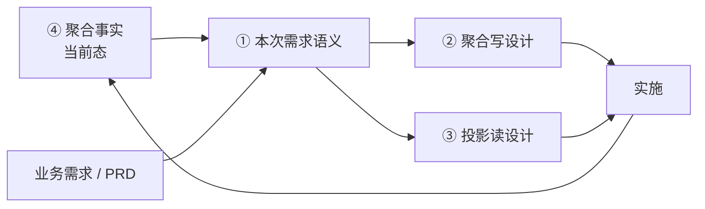
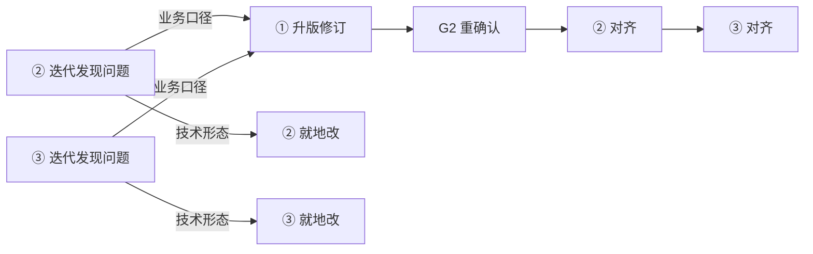

# 聚合设计文档标准（三契约 + 一快照 · 总说明与索引）

> 本文是 `ddd-design-doc` 能力产出设计文档的**总说明与索引**。
> 一个聚合的文档分四份：**三份契约**（本次需求语义 / 写设计 / 投影读设计）+ **一份快照**（聚合事实）。
> 本文只定义分层关系、交付节奏与通用规则，具体骨架见四份模板。

## 1. 为什么分契约与快照

契约回答「这次答应了什么」，快照回答「现在实际是什么」。两者混成一份，就会产生「文档写着 A、代码做着 B，而文档看起来是对的」这种最难查的问题。

- **契约**：每次需求产出一份，验收或实施后归档，不再修改。它是历史凭证，不是当前事实。
- **快照**：唯一一份，从代码推导，每次实施后覆盖更新。下次需求从这里读当前态。

分开之后，「业务说 A、实际是 B」会显性暴露在事实文档里，而不是被文档作者顺手抹平。

## 2. 四份文档与定位

| # | 文档 | 性质 | 定位 | 落盘 | 结束方式 |
| --- | --- | --- | --- | --- | --- |
| ① | [本次需求语义](./design-doc-semantics) | 契约 | 本次需求中它应该是什么 | `docs/design/changes/active/{需求}/{agg}/semantics.md` | 验收后归档 |
| ② | [聚合写设计](./design-doc-write-template) | 契约 | 本次怎么实现（写模型 + 关系表） | `docs/design/changes/active/{需求}/{agg}/aggregate-design.md` | 实施后归档 |
| ③ | [投影读设计](./design-doc-read-template) | 契约 | 本次怎么查（读模型 + 读源结构） | `docs/design/changes/active/{需求}/{agg}/projection-read.md` | 与②同批归档 |
| ④ | [聚合事实](./design-doc-facts) | **快照** | 现在实际是什么 | `docs/design/aggregates/{agg}/facts.md` | **永不归档** |

- ①②③ 共用同一个需求目录（`{YYYYMM}-{slug}` 或需求系统编号）；归档即把 `changes/active/{需求}/` 整体移到 `changes/archive/{需求}/`，不改名；目录标识本身即版本。
- 目录只有两条线：`changes/`（需求维度，活动 / 归档）与 `aggregates/`（聚合维度，只放 facts）；项目级前置条件清单在 `docs/design/prerequisites.md`。
- ② 为主文档，统管横切（改动清单 / 测试 / 风险 / 实施回填）；③ 不设这三章。
- ① 只写**本次受影响章节**，其余引用 ④ 基线（见 `design-doc-semantics` §1.2）；与事实的差异就地写在对应条目上。
- ④ **只写代码事实**，完全从代码推导，不依赖语义基线；未修问题只在 §4 保留摘要。

### 2.1 状态与版本戳

三份契约互相记录「基于哪一版」，不一致才可被检测出来：

| 文档 | 头部必写 | 状态取值 |
| --- | --- | --- |
| ① 语义 | `版本：vN ｜ 基线：④ 核对日` | 草稿 / 已确认 / 修订中 / 归档 |
| ② 写设计 | `基于：① vN（定稿日）+ ④ 核对日` | 待启动 / 草稿 / 待对齐 / 已确认 / 归档 |
| ③ 投影读 | `基于：② vN + ① vN` | 待启动 / 草稿 / 待对齐 / 已确认 / 归档 |

- ① 升版后，②③ 状态自动置「待对齐」，并在 ② §10.2 登记「尚未对齐 ① vN 的哪几条」。
- 状态不是「已确认」的文档不得交棒实施；未归档的文档不得被下一次需求当作基线引用。

## 3. 推导关系

- ①②③ 的推导是**单向**的：下游只翻译上游，不改写事实。
- ④ 的推导方向相反：**从代码推出**，吸收 ② 的 §10.6 回填。
- 下次需求从 ④ 起步，不从旧设计文档起步——旧文档已归档。

### 3.1 回流矩阵

推导单向下行，但**发现问题的方向可以是向上的**。下游对上游只能「提请」，不能自己落地；`②§10.x` 的待定表是登记台，不是修复台——只登记不回流，① 会被架空。

判别式：**改的是「业务上说得通吗」→ 回 ①；改的是「技术上怎么落」→ 停在 ②③；两句话都沾 → 先拆成两件事，分别落。**

| # | 在哪发现 | 发现什么 | 回流到 | 动作 |
| --- | --- | --- | --- | --- |
| B1 | ② | 要新增 / 改一条业务规则 R | **①** | ①§5 加规则与编号 → ① 升版定稿 → ②§4、§1.4 对齐 |
| B2 | ② | 要加一个动作，或动作写入的字段变了 | **①** | ①§3 先改 → ②§3、§6 对齐 |
| B3 | ② | 事件载荷不够用（要加字段） | **①** | ①§4.1 载荷先改 → ②§5 对齐 |
| B4 | ② | 状态维度或流转条件变了 | **①** | ①§6 先改 → ②§3.3、§3.4 对齐 |
| B5 | ② | 表结构、索引、TypeHandler、执行顺序、操作码与消息码常量 | **止于 ②** | 记 §10.1 设计增量，不惊动 ① |
| B6 | ③ | 需要一个 ① 里没有的查询场景 Q | **①** | ①§8 新增 Q（编号只增）→ ① 定稿 → ②（涉及字段 / 索引时）→ ③ |
| B7 | ③ | 查询要的字段 ② 的表里没有 | 属性在 ① 有 → **②**；① 也没有 → **①** | 先判「业务属性缺失」还是「持久化缺失」 |
| B8 | ③ | 数据同步事件不够用（时机 / 载荷无法构造投影） | **①**（§4）+ **②**（§5、§6.8） | 载荷与时机属业务事实，不回 ① 就只能瞎补 |
| B9 | ③ | 读源选型、mapping、`REPLICA_ID`、TTL、分片、裁剪粒度、分页、查询索引 | **止于 ③** | 就地改，② 不动 |
| B10 | ③ | 业务筛选维度口径不明（如「近 7 天」从哪天算） | **①** | ①§8 + 附录 A 术语口径 |
| B11 | 任意 | 与 ④ 事实不一致 | ④ 记现状 + ① 就地标 `（当前：xxx）` | 不擅自抹平差异 |

两条总则：

1. **上游优先、单一落点**：业务事实只有 ① 一个写入口。②③ 发现要加规则 / 动作 / 字段 / 载荷，先回 ① 改并定稿，再回 ②③ 对齐。
2. **不跳级**：回流一次只往回走一档，顺序固定 `① 定稿 → ② 对齐 → ③ 对齐`。① 未定稿就改 ③，等于在流沙上盖房。

### 3.2 闸门重走

回流不是补丁，而是重走闸门：① 进入「修订中」，定稿后 G2 重过 → ② 对齐 → ③ 对齐。流程图与硬约束见 §5.5。

## 4. 通用规则

- **结论先行、不写论证**：只产出产物（表 / 骨架 / DDL / mapping / 清单），不写「为什么这么设计」。
- **单一事实源**：业务意图只在 ①，当前实现只在 ④，技术形态只在 ②③。
- **编号稳定**：规则 `R1..Rn`、查询 `Q1..Qn` 跨文档不变，分配后不重排。
- **未定项集中**：框架签名、业务待确认、实施偏差全部收在 ② §10。
- **前置条件先行**：动笔前核对 [实施前置条件](./design-doc-prerequisites)，未确认项只写结构与占位。
- **一次只产一份**：一次交付只写一份文档的完整正文，不批量铺开 ①②③；②③ 按 G3 / G4 点单产出，未点名不写。
- **上游优先**：业务事实只在 ① 落地；下游只提请不改写，回流规则见 §3.1。
- **三份契约归档、快照不归档**：①②③ 实施后冻结；④ 随代码持续更新。
- **不设接口层章节**：HTTP / RPC 端点、Request / Response DTO 不在四份范围内。

## 5. 交付节奏：闸门与迭代轮次

一份需求不是一口气写完四份文档，而是**过一道闸门、出一份文档、确认后再走下一道**。

### 5.1 四道闸门

| 闸门 | 进入条件 | 产出 | 不过闸时怎么办 |
| --- | --- | --- | --- |
| G1 语义开写 | 需求已给、④ 已读、前置条件已核 | ① 第 1 轮草稿 | — |
| G2 语义定稿 | 用户显式说「定稿 / 可以了」；附录 C 无「未定」；自检 16 条通过 | ① 状态改「已确认」，记确认人与日期 | 继续迭代，不越界改用户没提的章节 |
| G3 写设计开写 | G2 已过 **且** 用户明确要求出写设计 | ② | 问用户：现在要出写设计吗？ |
| G4 投影读开写 | G3 已过 **且** 用户明确要求出投影读设计 | ③ | 问用户：查询场景要不要落成投影？先澄清读源 |

- **②③ 是点单，不是默认全出**：① §8 有 Q 编号只说明「要能被查」，不说明本次要做投影。不做时在 ① 或 ② 末尾写一句决定（暂不支持 / 下游另行承接）；**走数据库直读不算「不做」**，直读仍要产出 ③ 并在 §4.3 写读源形态。
- **一次交付只写一份**：① 未确认不得动 ②③；② 未定稿不得顺手开 ③。

### 5.2 语义文档的迭代轮次（G1 → G2）

| 轮次 | 做什么 | 不做什么 |
| --- | --- | --- |
| 第 1 轮 | 新建：全量 8 章骨架；迭代：受影响章节 + 基线引用；待确认项全部进附录 C | 不猜业务、不替业务方编查询场景 |
| 第 2..N 轮 | 只改本轮指出的章节 + 被其连带影响的章节（改动作则 3.1 / 3.2 / 5.3 / 6.4 同批对齐）；R / Q 编号只增不改 | 不整篇重写、不重排编号、不顺手美化未触及章节 |
| 每轮汇报 | 三行：本轮改了哪几章 / 新增或改动了哪些 R·Q·动作 / 附录 C 还剩什么 | 不汇报未改动的内容 |
| 定稿轮 | 跑语义模板自检，附录 C 清空或逐条标「接受」，头部状态改「已确认」 | 定稿后不静默修改（要改就升版） |

### 5.3 新建聚合

1. 定需求名并建目录：`changes/active/{需求}/{agg}/`（可用 `agent-skills/scripts/design-doc-workspace.sh new <需求> <agg>`）。
2. 核对前置条件清单。
3. **G1 → G2**：写 ①（全量，头部标「基线：无（新建）」）→ 按 §5.2 迭代 → 交业务方确认。
4. **G3**：问用户是否出写设计，确认后写 ②。
5. **G4**：问用户是否出投影读设计，确认后写 ③。
6. 一致性校验（§5.6）+ 各份自检。
7. 实施。
8. 填 ② §10.6 → 产 ④ 初始版本（从代码推导）→ **归档**（需求目录从 `active/` 移到 `archive/`）。

### 5.4 迭代需求

1. 读 ④ 当前态：`aggregates/{agg}/facts.md`。
2. 核对前置条件清单。
3. 建新需求目录 `changes/active/{新需求}/{agg}/`。
4. **G1 → G2**：写 ① 本次需求语义（按章标「重列 / 无变更，见基线 / 新增 / 废弃」，头部标基线版本）→ 按 §5.2 迭代 → 确认。
5. **G3 / G4**：同 §5.3 第 4–5 步（同目录，文件名不带版本号）。
6. 实施。
7. 填 ② §10.6 → **覆盖更新 ④**（含 §4 偏离）→ **归档**。

第 7 步是硬约束：④ 未更新，下次迭代不得开始。

### 5.5 回流与闸门重走

②③ 迭代中发现上游缺东西，按 §3.1 回流矩阵处理，闸门**重走且逐级只回一档**：

- ① 处于「修订中」时，②③ 不得继续推进；① 定稿后 ②③ 置「待对齐」，按 ② → ③ 顺序补齐。
- ③ 是最容易暴露 ① 缺口的环节（查询场景最晚想清），③ 的每次回流都要在 ② §10.2 留一行，避免下次重复发现。

### 5.6 一致性校验（交付前、归档前各跑一次）

用集合关系核对，不靠肉眼（未产出 ③ 时第 2–4 条跳过；未产出 ② 时只跑第 1 条与归档判据）：

1. ① 的 R / 动作 / 事件 / 状态维度 **⊆** ② §1.4 追溯覆盖面，且 ② 不得出现 ① 没有的动作。
2. ③ 的 Q 集合 **=** ① §8 的 Q 集合（不多不少、编号不改）。
3. ③ §1.2 来源事件 **⊆** ② §5.1 事件清单。
4. ③ §3.1 投影字段 **⊆** ② §7 表结构（枚举已降级）。
5. 归档前：② §10.6 与 ④ 一致、① 无「未定」项、②③ 状态不为「待对齐」。

### 5.7 归档与止损

**归档动作**固定为目录移动：`changes/active/{需求}/` → `changes/archive/{需求}/`。三条判据全满足才移动：①②③ 完成、涉及的 `aggregates/{agg}/facts.md` 已更新、② §10.6 已回填。

两条止损线：

- **① 升版 ≥ 3 次**：说明需求本身没定，停下来回业务澄清，不要在设计里试错。
- **归档后不得回改 ①**：归档目录是历史凭证；发现遗漏开新需求目录写增量语义，否则 ①②③ 的版本关系断裂。

## 6. 与旧文档的映射

早期版本把设计文档分成「写 / 读」两份（12 节 / 7 节），后演进为三层，现为三契约 + 一快照。已产出的旧文档按此表对齐：

| 旧内容 | 现在的位置 |
| --- | --- |
| 原 §1 概述与背景、聚合边界与职责 | ① 语义第 1 章 |
| 原 §3 领域模型静态结构 | ② 写 §2 |
| 原 §4 状态与行为设计 | ② 写 §3 |
| 原 §5 业务规则设计 | ② 写 §4（业务表述在 ① 第 5 章） |
| 原 §6 领域事件设计 | ② 写 §5（业务含义在 ① 第 4 章） |
| 原 §7 表结构 / 映射 / 仓储 | ② 写 §7（实际列与索引进 ④ §3.4） |
| 原 §8 应用层设计 | ② 写 §6 |
| 原 §9 接口层设计 | 不写 |
| 原 §10 时序 | 并入 ② 写 §6 执行顺序 |
| 原 §11 改动清单 / §12 测试 / §13 风险 | ② 写 §8 / §9 / §10 |
| 原投影部分 | ③ 投影读整份 |
| 原「聚合当前态」类文档 | ④ 聚合事实 |

## 7. 存量项目怎么起步

存量项目没有 ④，直接写 ① 会失去基线。推荐顺序：

1. **先补 ④**：用「现状型」入口从代码推导事实文档（`design-doc-facts` §6.1 给了核对顺序）。
2. 再对**本次要改的聚合**补 ①，其余聚合等有需求时再补。
3. 不要为没有需求的聚合预先补文档——补出来的没人用，只会过期。

## 8. 已知缺口

| 缺口 | 现状 | 后续 |
| --- | --- | --- |
| 前置条件清单模板 | 仓库 `docs/design/prerequisites.md`（项目数据）；模板示例 `docs/design/documentation/实施前置条件清单示例.md`，均未进文档站 | 按项目实际情况定 |
| ④ 的自动生成 | 模板已定义推导顺序，尚无脚本或 skill 步骤实现 | 集成进 `ddd-design-doc` 的现状型分支 |
| 语义多轮留痕 | 目前只靠头部状态行 + git，无逐轮 diff 记录 | 按需补轮次日志 |
